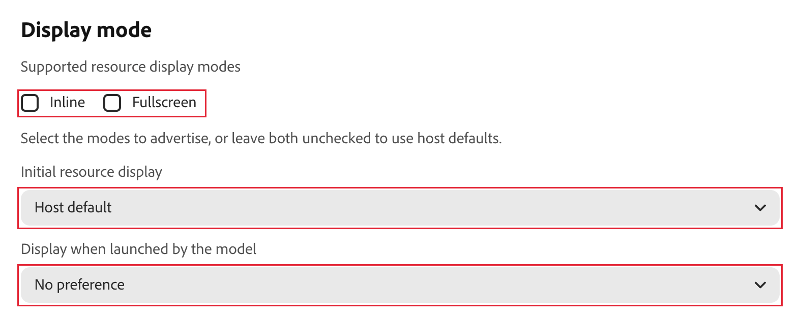

# ChatGPT 확장 구성 {#chatgpt-extensions}

>[!IMPORTANT]
>
>LLM 앱은 모든 AEM Sites Cloud Service 고객이 자체 앱을 개발하고 관리할 수 있습니다. 계량이 시작되면 각 앱 호출은 고객의 AEM Sites 콘텐츠 요청에 계산됩니다. Adobe은 계량 시행 전 계량 요율과 시작 날짜를 발표합니다.

**ChatGPT 전용 확장입니다.** [!DNL Claude] 또는 다른 LLM 플랫폼에서 기능을 구성하지 않습니다. 앱은 표준 작업 및 위젯을 통해 이러한 플랫폼에서 계속 작동할 수 있습니다.

**[!UICONTROL ChatGPT 확장 기능]**&#x200B;을 사용하면 사용자가 앱을 직접 열거나 대화 옆에 보관하거나 지원되는 파일을 보거나 메시지를 작성하는 동안 항목을 찾을 수 있습니다.

**이 안내서:** 이러한 선택적 기능을 구성하는 방법과 이를 사용하여 수행할 수 있는 작업에 대해 알아봅니다. 제품 카탈로그가 예입니다. 앱에 필요한 기능만 활성화하십시오.

스크린샷의 빨간색 윤곽선은 단계에 사용된 강조 표시 컨트롤입니다. UI 오류 표시기가 아닌 설명서 주석입니다.

## 시작하기에 앞서 {#before-you-begin}

다음이 필요합니다.

- 기존 LLM 앱, 작업 편집 권한 및 작업에 대한 작업 작업입니다.
- 직접 열기 또는 파일 보기를 위한 게시된 위젯입니다. 텍스트 전용 작업에서는 설명 검색을 제공할 수 있지만 진입점은 제공할 수 없습니다.
- `@adobe/llm-apps-runtime` 1.3.0 및 위젯 기능의 경우 `@adobe/llmapps-sdk` 0.2.1 이상 지원 버전. 필요한 경우 앱 관리자에게 문의하여 두 버전을 확인하고 제공된 위젯 스크립트를 업데이트하십시오.
- 연결된 앱 및 선택한 확장을 지원하는 클라이언트입니다.

>[!IMPORTANT]
>
>이용 가능 여부는 클라이언트마다 다릅니다. 파일 진입점은 **데스크톱 전용**&#x200B;입니다. 작성기 언급 시 **데스크톱 또는 작업 브라우저**&#x200B;가 필요합니다. OpenAI의 웹 지원 열은 클래식 [!DNL ChatGPT]을(를) 제외합니다. 테스트하기 전에 [플랫폼 지원](https://github.com/openai/mcp-extensions/blob/main/docs/spec.md#platform-support)을 확인하세요.

>[!IMPORTANT]
>
>설정이 파일 뷰어를 빌드하거나 검색을 구현하지 **않습니다**. 먼저 관리자가 필요한 [작업](/help/guides/customize-handler.md) 및 [위젯](/help/guides/widgets.md)을 준비하도록 합니다.

## Open ChatGPT 확장 {#open-extensions}

1. 앱을 열고 **[!UICONTROL 작업]**&#x200B;을 선택합니다.
1. 구성할 작업을 엽니다.
1. **[!UICONTROL ChatGPT 확장]** 탭을 선택합니다.

탭은 작업을 생성하는 동안에도 사용할 수 있습니다. 이 안내서에서는 검토된 기존 작업을 사용합니다.

편집한 후 **[!UICONTROL 변경 내용 저장]**&#x200B;을 선택합니다. 구성을 게시하려면 [앱 배포](/help/guides/deploy-your-app.md) 및 [ChatGPT 연결 새로 고침](/help/guides/test-in-chatgpt.md#refresh-after-app-changes)을 따르십시오.

## 사람들이 앱을 여는 위치 선택 {#configure-entrypoints}

**진입점**&#x200B;은(는) 사람들이 모델에 호출을 요청하지 않고 앱을 여는 위치입니다.

>[!NOTE]
>
>동일한 위젯에 대해 여러 진입점을 선택할 수 있습니다. 진입점은 진입점을 여는 추가적인 방법을 제공합니다. 일반적인 채팅 호출을 대체하지 않습니다. 작업이 모델에 제공되면 채팅에서 작업을 요청하고 해당 위젯을 수신할 수 있습니다.

1. **[!UICONTROL 진입점]**&#x200B;에서 선택적으로 **[!UICONTROL 아이콘 URL]**&#x200B;에 공개 HTTPS 이미지 URL을 입력하십시오. 아이콘은 이 작업의 진입점에서 공유됩니다. 게시할 수 있는 이미지를 사용하십시오.
1. **[!UICONTROL 사용자가 이 앱을 열 수 있는 위치]**&#x200B;에서 동일한 위젯에 대해 다음 확인란 조합을 선택합니다. 작업을 직접 열지 않아도 되는 경우 모두 선택하지 않은 상태로 둡니다.

   | 유형 | 결과 |
   |---|---|
   | **[!UICONTROL 전역]** | 탐색에서 카탈로그 전체 화면 열기 |
   | **[!UICONTROL 스레드]** | 대화 옆에 탭으로 카탈로그를 엽니다. |
   | **[!UICONTROL 파일]** | 사용자 지정 뷰어에서 일치하는 파일 열기 |

1. 글로벌 또는 스레드의 경우 필수 입력 없이 작업이 작동하는지 확인합니다.
1. 파일의 경우 아래 설정을 완료합니다.

예를 들어, 탐색이나 대화 옆에서 동일한 카탈로그 위젯을 열려면 [전역]과 [스레드]를 모두 선택합니다. 위젯에서 파일 보기를 지원하는 경우 파일 을 선택할 수도 있습니다. 파일이 전역 또는 스레드와 결합되면 `file` 입력에 대해 **[!UICONTROL 필수]**&#x200B;을 선택하지 않은 상태로 둡니다. 파일 시작은 파일 개체를 제공하지만 전역 및 스레드 시작은 입력 없이 제공됩니다. 처리기와 위젯은 두 가지 경우를 모두 지원해야 합니다. 파일 전용 작업에는 `file`이(가) 필요합니다.

**예상 결과:** 탐색에서 전역 또는 스레드의 대화 측 탭으로 카탈로그를 엽니다.

### 탐색 또는 대화에서 열기 {#test-global-thread}

다음 사용자 제공 스크린샷은 카탈로그 예제가 아닌 **Home** 대시보드를 보여 줍니다. 탐색 및 메뉴 위치는 클라이언트마다 다를 수 있습니다.

**전역**&#x200B;의 경우 탐색 메뉴를 열고 앱의 진입점을 선택하십시오. 이 예제에서 진입점은 **Home**&#x200B;입니다.

![탐색 메뉴가 열려 있고 [홈]이 전역 진입점으로 강조 표시된 전체 ChatGPT 창](/help/assets/guide-chatgpt-extensions/global-entrypoint-menu.png)

대시보드가 전체 화면으로 열리는지 확인하고 탐색 레일을 계속 사용할 수 있습니다.

**스레드**&#x200B;에 대해 대화 메뉴를 열고 **[!UICONTROL 플러그인]**&#x200B;을 선택한 다음 진입점을 선택하십시오. 새 프롬프트가 없어도 대화 옆에 위젯이 열리는지 확인합니다.

### 앱에서 지원되는 파일을 엽니다. {#file-entrypoint}

준비된 CSV 카탈로그 뷰어:

1. **[!UICONTROL 파일]** 확인란을 선택하고 **[!UICONTROL 확장 추가]**&#x200B;를 선택한 다음 `.csv`을(를) 입력하십시오. 지원되는 각 확장을 자체 필드에 추가합니다.
1. **[!UICONTROL 작업 세부 정보]** > **[!UICONTROL 입력 매개 변수]**&#x200B;에서 `name` 및 `resourceUri`을(를) 허용하는 `file`(이)라는 **Object** 매개 변수를 확인하십시오. 파일을 선택하면 `file` 매개 변수가 없는 경우 선택적 개체 입력이 추가됩니다. 기존 정의를 확인하십시오. 다른 입력은 필요하지 않습니다. 전역 또는 스레드도 선택한 경우 `file`을(를) 선택 사항으로 유지합니다.
1. 지원되는 데스크톱 클라이언트에서 앱으로 민감하지 않은 `.csv` 파일을 엽니다.

**예상 결과:** 위젯에 파일이 표시됩니다. 편집 내용을 저장하려면 편집 지원 및 쓰기 가능한 파일이 구현되어야 합니다.

>[!IMPORTANT]
>
>파일 진입점은 업로드된 파일 매개 변수와 다릅니다. 이 사용자는 업로드 다운로드 URL 또는 파일 ID가 아닌 열린 파일 리소스 참조를 받습니다.

## 앱 표시 방법 선택 {#display-settings}

**[!UICONTROL 표시 모드]**&#x200B;에서:

1. 모델이 실행하는 경우 **[!UICONTROL 디스플레이 설정]**&#x200B;을(를) `inline`, `fullscreen` 또는 **[!UICONTROL 환경 설정 없음]**(으)로 설정합니다.
1. 위젯의 **[!UICONTROL 지원되는 리소스 표시 모드를 선택하십시오]**: 인라인, 전체 화면 또는 둘 다. 호스트 기본값을 사용하려면 두 옵션을 모두 선택 취소하십시오.
1. **[!UICONTROL 초기 리소스 표시]**&#x200B;를 선택하십시오. 지원되는 모드를 선택한 경우 초기 모드를 포함해야 합니다.

기본 설정입니다. [!DNL ChatGPT]님이 최종 프레젠테이션을 선택합니다. 전체 화면에서 사이드 패널 탭을 만들지 않습니다. 스레드 진입점을 사용하십시오.

광고하는 각 모드에서 위젯을 계속 사용할 수 있는지 확인합니다.

## 사람들이 작성기에서 리소스를 찾도록 허용 {#composer-mentions}

작성기 언급을 사용하면 메시지를 작성하는 동안 카탈로그 항목을 검색하고 선택할 수 있습니다. 선택 가능한 검색 결과를 이미 반환하는 작업을 사용합니다.

1. 검색 작업을 열고 **[!UICONTROL 작업 세부 정보]**&#x200B;를 선택합니다.
1. 다른 필수 입력 없이 빈 텍스트를 허용하는 `query`(이)라는 **String** 입력을 확인합니다.
1. **[!UICONTROL LLM 설정]**&#x200B;에서 **[!UICONTROL 읽기 전용 힌트]** 및 **[!UICONTROL 앱 표면에 위젯으로 표시]**&#x200B;를 사용하도록 설정합니다. 검색 작업은 실제로 읽기 전용이어야 합니다.
1. **[!UICONTROL ChatGPT 확장 기능]**&#x200B;에서 **[!UICONTROL 작성기 언급 사용]**&#x200B;을 켭니다.
1. 앱당 하나의 공급자만 허용됩니다. 하나를 바꾸는 경우 이전 공급자에서 언급을 비활성화하고 새 공급자를 활성화하기 전에 저장하십시오.

**예상 결과:** 앱의 작성기 언급 검색에서 알려진 제품을 검색하고 선택한 다음, 의도한 리소스가 메시지에 참조되었는지 확인합니다.

가시성 설정을 통해 앱에서 검색 작업을 사용할 수 있습니다. 제공자는 자체 시각적 위젯이 필요하지 않습니다.

다음 예제에서는 카탈로그가 아닌 합성 문서를 검색하는 텍스트 전용 작업인 **검색 언급**&#x200B;을 사용합니다. 해당 `query` 입력은 **필수**&#x200B;이(가) 선택 취소된 **문자열**&#x200B;입니다.

동일한 작업의 **[!UICONTROL ChatGPT 확장 기능]** 탭에서 **[!UICONTROL 작성기 언급 사용]**&#x200B;이 설정되어 있습니다.

다른 작업에서 이미 언급 검색을 제공하는 경우 토글을 사용할 수 없으며 경고가 표시되어 해당 작업을 식별합니다. 기존 공급자에 대한 언급을 비활성화하고 대체 기능을 활성화하기 전에 저장하십시오.

## 추가 ChatGPT 위젯 기능 {#additional-widget-features}

SDK은 또한 ChatGPT별 딥링크, 확장된 선택 컨텍스트, 편집 가능한 초안 및 대화 타깃팅을 지원합니다. 이를 위해서는 이 탭의 다른 스위치가 아닌 위젯 구현이 필요합니다.

| 위젯에서 다음을 제공하는 경우 | 시도 |
|---|---|
| 항목에 대한 링크 | 링크를 열고 의도한 제품이 표시되는지 확인합니다 |
| 선택 컨텍스트 | 민감하지 않은 제품을 선택하고 질문합니다. |
| 초안 또는 새 대화 제어 | 메시지가 예상대로 열리고 초안이 자동으로 제출되지 않는지 확인합니다. |

기본 위젯 메시지와 기타 표준 SDK API는 ChatGPT 전용이 아닙니다. 위젯이 구현하는 확장을 관리자에게 문의하십시오. [SDK 설명서](https://www.npmjs.com/package/@adobe/llmapps-sdk)를 참조하십시오.

## 확장 변경 또는 제거 {#change-or-remove}

같은 탭에서 진입점의 확인란을 지우거나 **[!UICONTROL 작성기 언급 사용]**&#x200B;을 끕니다. 확장명이 남아 있지 않으면 파일 선택을 취소합니다. 공유 아이콘을 제거하려면 **[!UICONTROL 아이콘 지우기]**&#x200B;를 선택하십시오. 표시 기본값을 복원하려면 **[!UICONTROL 기본 설정 없음]**&#x200B;을 선택하고 지원되는 모드를 지운 다음 **[!UICONTROL 호스트 기본값]**&#x200B;을 선택하십시오.

진입점을 제거해도 작업 또는 사용자 파일은 삭제되지 않습니다. [필드 정의 및 규칙](/help/reference/reference-docs.md#chatgpt-extension-fields)을 참조하세요.

## 문제 해결 {#troubleshooting}

| 표시되는 항목 | 할 일 |
|---|---|
| 기능 또는 컨트롤이 없습니다. | [클라이언트 지원](#before-you-begin)을 확인하세요. 진입점의 경우 위젯이 구성되어 있는지 확인합니다. 이러한 확장 기능은 클라우드 또는 다른 호스트에는 적용되지 않습니다 |
| 호환되지 않는 필수 입력인 보고서 저장 | 글로벌/스레드 공급 입력 없음, 파일 공급 `file` 및 언급 공급 `query`. 관리자에게 불일치를 해결하도록 요청하십시오. 작업에 필요한 입력을 제거하지 마십시오. |
| 파일 설정 또는 보기 실패 | 지원되는 확장을 추가하고 개체 `file` 입력을 확인하고 호환되는 데스크톱 클라이언트를 사용하십시오. 위젯은 해당 파일 형식을 구현해야 합니다 |
| 파일 저장 실패 | 편집 지원 및 쓰기 권한을 확인합니다. 새로운 콘텐츠를 덮어쓰는 대신 충돌을 조정. 크기를 초과한 콘텐츠 감소 |
| 아이콘 URL을 저장할 수 없습니다. | 올바른 이미지 URL 또는 데이터 URI를 입력하거나 선택적 아이콘을 지웁니다. 공개 HTTPS 이미지 URL 선호 |
| 디스플레이 설정이 거부되거나 무시됨 | 지원되는 모드 중에서 초기 모드를 포함하십시오. ChatGPT는 최종 프레젠테이션을 제어합니다. |
| 멘션을 활성화할 수 없음 | 읽기 전용 동작, 앱 가시성 및 `query` 입력을 확인합니다. 교체를 활성화하기 전에 이전 공급자의 제거를 저장합니다. |
| 항목이 없거나 오류가 반환됨 | 알려진 항목을 사용해 보십시오. 빈 결과는 유효할 수 있습니다. 알려진 항목 또는 오류가 누락된 경우 검색 유지 관리자에게 보고하십시오. |
| 작업을 로드할 수 없음 | 제공되는 경우 **[!UICONTROL 앱 작업 로드 다시 시도]** 또는 **[!UICONTROL 앱 작업 새로 고침]**&#x200B;을 사용합니다. |
| 초안 작성 실패 | 클라이언트 지원을 확인하십시오. 초안으로 의도한 메시지를 자동으로 보내지 않음 |
| 저장된 변경 사항이 누락되었습니다. | 테스트된 환경에 배포하고, 연결을 새로 고치고, 위젯 변경 사항이 게시되는지 확인합니다. |
| 지원되지 않는 설정 진입점이 저장을 차단함 | 지원되는 글로벌, 스레드 또는 파일 확인란을 선택하거나 모든 확인란을 선택 취소합니다 |

지원을 위해 앱, 환경, 클라이언트, 실패한 단계 및 표시되는 오류를 기록합니다. 토큰, 비공개 URL 또는 중요한 데이터를 포함하지 마십시오.

## 다음 단계 {#whats-next}

- [앱 배포](/help/guides/deploy-your-app.md)
- [LLM 앱을 ChatGPT 플러그인으로 테스트](/help/guides/test-in-chatgpt.md)
- [생성된 위젯 사용자 정의](/help/guides/widgets.md)
