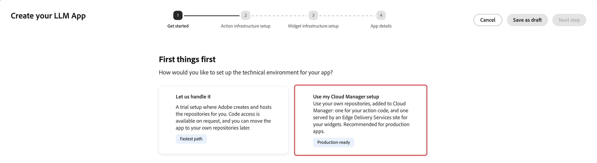

# 인프라 설정 {#create-first-app}

>[!IMPORTANT]
>
>LLM 앱은 모든 AEM Sites Cloud Service 고객이 자체 앱을 개발하고 관리할 수 있습니다. 계량이 시작되면 각 앱 호출은 고객의 AEM Sites 콘텐츠 요청에 계산됩니다. Adobe은 계량 시행 전 계량 요율과 시작 날짜를 발표합니다.

인프라는 앱을 위한 기술적 기반입니다. 즉, 코드를 저장하는 저장소와 작업 핸들러를 실행하고 사용자에게 위젯을 전달하는 서비스입니다.

[개요](/help/overview/overview.md#key-concepts)에 설명된 대로 **작업 처리기**&#x200B;가 제품 찾기와 같은 작업을 수행하는 반면 **위젯**&#x200B;은(는) 그 결과를 대화의 대화형 경험으로 표시합니다.

[!DNL LLM Apps]은(는) 처리기 및 위젯 소스 코드를 두 개의 별도 저장소에 저장합니다.

- **작업 리포지토리** — 서버측 처리기와 해당 테스트가 포함되어 있습니다.
- **위젯 리포지토리** — 대화형 위젯의 코드와 스타일을 포함합니다.

예를 들어 제품 검색 처리기는 일치하는 제품을 검색하고 해당 위젯에 제품 카드로 표시됩니다. 저장소는 해당 코드를 저장합니다. Adobe I/O Runtime은 배포된 처리기를 실행하고 Edge Delivery Services은 위젯을 제공합니다.

설정 마법사는 이러한 저장소를 준비하고 앱에 필요한 서비스를 연결합니다. 다음 두 옵션 중 하나를 선택합니다.

- **[!DNL LLM Apps]관리 인프라**&#x200B;을(를) 시작하는 가장 빠른 방법입니다. Adobe은 작업 핸들러 및 위젯에 대한 저장소를 생성하고 호스팅하므로 저장소를 직접 설정할 필요가 없습니다.
- **자신의 저장소** 소유한 저장소에 앱 코드를 보관하고 [!DNL Cloud Manager]에 추가했습니다. [!DNL GitHub], [!DNL GitHub Enterprise], [!DNL GitLab], [!DNL Bitbucket] 또는 [!DNL Azure DevOps]에서 호스팅할 수 있습니다. 플랫폼은 필요한 프로젝트 파일로 빈 저장소를 초기화하므로 미리 작업 또는 위젯 코드를 준비할 필요가 없습니다.

**이 안내서:** 인프라 옵션을 선택하고 설치 마법사로 앱을 만드는 방법을 알아봅니다. 설치 후 [작업 만들기](/help/guides/creating-actions.md)를 계속합니다.

앱을 만드는 동안 작업 생성이 **시작되지**&#x200B;않습니다. 앱 페이지와 별도로 작업 생성을 시작합니다.

## 앱 만들기 마법사를 엽니다.

[Adobe LLM 앱](https://experience.adobe.com/llm-apps)을 엽니다. 시작 페이지에서 **[!UICONTROL 시작]**&#x200B;을 선택합니다. 이미 열려 있는 앱이 있는 경우 앱 선택기를 사용하여 **[!UICONTROL 새 앱 만들기]**&#x200B;를 선택합니다.

**[!UICONTROL LLM 앱 만들기]** 마법사는 **[!UICONTROL 시작]**(으)로 시작합니다. 기술 환경을 설정하는 방법을 선택합니다.

| 인프라 옵션 | 마법사에서 선택 | 의미 |
|---|---|---|
| **[!DNL LLM Apps]관리 인프라** | **[!UICONTROL 처리하게 해 주세요]** | Adobe은 앱에 대한 저장소 및 연결된 서비스를 만들고 관리합니다. 요청에 따라 코드 액세스를 사용할 수 있습니다. |
| **자신의 저장소** | **[!UICONTROL 내 Cloud Manager 설정 사용]** | [!DNL Cloud Manager]에 추가된 두 개의 저장소를 선택합니다. 하나는 작업 처리기용이고 다른 하나는 위젯용입니다. 플랫폼에서는 파일이 비어 있는 경우 초기화합니다. |

두 옵션 모두 나중에 자동 작업 생성을 지원합니다. 두 옵션 모두 작업을 수동으로 쓸 필요가 없습니다.

## [!DNL LLM Apps] 관리 인프라 사용 {#adobe-managed-infrastructure}

이 옵션을 사용하여 Adobe에서 앱에 대한 저장소 및 연결된 서비스를 설정하고 관리하도록 할 수 있습니다. 저장소를 만들거나 [!DNL GitHub] 앱을 직접 설치할 필요가 없습니다.

1. **[!UICONTROL 처리 허용]**&#x200B;을 선택하세요.
2. **[!UICONTROL 다음 단계]**&#x200B;를 선택합니다.
3. [앱 세부 정보](#app-details)를 완료합니다.
4. **[!UICONTROL 앱 만들기]**&#x200B;를 선택합니다.

Adobe이 저장소를 준비하고 위젯 사이트를 연결하는 동안 앱 페이지에는 **[!UICONTROL 앱 설정]**&#x200B;이 표시됩니다. UI는 일반적으로 설정이 1~2분 정도 소요됨을 나타냅니다. 작업, 테스트 및 배포는 설정이 준비될 때까지 사용할 수 없습니다.

설치에 실패하면 오류를 읽고 **[!UICONTROL 다시 시도]**&#x200B;를 선택하세요. 페이지에서 진행률을 확인할 수 없는 경우 백그라운드에서 설치를 계속합니다. **[!UICONTROL 다시 확인]**&#x200B;을 선택하여 다시 연결합니다.

설치가 완료되면 [작업 만들기](/help/guides/creating-actions.md)를 계속합니다.

## 고유한 저장소 사용 {#your-own-repositories}

**[!UICONTROL 내 Cloud Manager 설정 사용]**&#x200B;을 선택한 후 **[!UICONTROL 다음 단계]**&#x200B;을 선택하십시오. 이 경로에는 네 가지 마법사 단계가 있습니다.

**→ 인프라 설정 → 위젯 인프라 설정 → 앱 세부 정보를 시작합니다.**

[!DNL LLM Apps]이(가) Adobe 계정을 사용하여 [!DNL Cloud Manager]을(를) 통해 저장소에 도달합니다. [!DNL GitHub] 앱을 설치하지 않습니다.

### 시작하기에 앞서 {#own-repositories-prerequisites}

- 앱이 속할 [!DNL Cloud Manager] 프로그램에 대한 액세스 권한.
- 두 개의 저장소, 즉 작업 처리기와 위젯에 대한 저장소가 있습니다. git 호스트가 생성한 README만 포함된 저장소를 포함하여 빈 저장소는 문제가 없습니다.
- 두 저장소 [이(가) 개인 저장소로 Cloud Manager에 추가됨](https://experienceleague.adobe.com/en/docs/experience-manager-cloud-manager/content/managing-code/external-repositories)&#x200B;(소유권이 확인됨) 및 상태 **준비**. [!DNL Cloud Manager]은(는) 쓸 수 있어야 합니다. 읽기 전용 액세스 토큰으로는 충분하지 않습니다.

직접 호스트하는 저장소만 나열됩니다. [!DNL Cloud Manager]에서 Adobe이 호스팅하는 저장소는 지원되지 않습니다.

#### 위젯 저장소는 Edge Delivery Services 사이트입니다. {#widget-repository-is-an-eds-site}

위젯은 [!DNL Edge Delivery Services]&#x200B;(EDS) 사이트에서 제공되며 위젯 저장소에 해당 사이트의 코드가 보관됩니다. 위젯 리포지토리가 EDS 사이트에 속하는지, 아니면 속하는지 확인합니다. 두 가지 방법으로 하나를 설정할 수 있습니다.

- **자체 Git을 사용하는 모든 Git 공급자** [!DNL Cloud Manager]에서 EDS 사이트를 만들고 **고유한 Git 가져오기**&#x200B;를 사용하여 저장소에 연결합니다. 그런 다음 [!DNL Cloud Manager]은(는) 저장소의 코드를 사이트에 동기화합니다. 마법사를 시작하기 전에 이 작업을 수행하십시오. [Git 가져오기](https://www.aem.live/developer/byo-git)를 참조하세요.
- **AEM 코드 동기화를 사용하는 [!DNL GitHub] 리포지토리입니다.** [Edge Delivery Services 자습서](https://www.aem.live/developer/tutorial)와 같이 EDS 사이트를 직접 설정합니다. 마법사는 저장소의 유효성을 검사한 후 AEM 코드 동기화 설치 및 액세스 확인 과정을 안내합니다.

위젯 단계에서는 적용되는 사례를 감지합니다. [위젯 인프라 설정](#set-up-the-widget-infrastructure)을 참조하세요.

>[!TIP]
>
>회사에 이미 EDS 사이트가 있더라도 [!DNL LLM Apps] 위젯에 대해 별도의 EDS 사이트를 만드십시오.

>[!NOTE]
>
>빈 저장소의 경우 유효성 검사가 초기 프로젝트 파일을 기록합니다. **[!UICONTROL 저장소 유효성 검사]**&#x200B;를 선택하기 전에 이 앱에 사용할 저장소를 선택하십시오.

### 작업 인프라 설정

작업 리포지토리에는 LLM 플랫폼이 작업을 호출할 때 실행되는 서버측 처리기와 테스트가 포함되어 있습니다.

1. **[!UICONTROL Cloud Manager 프로그램]**&#x200B;에서 작업 리포지토리가 포함된 프로그램을 선택합니다.
2. **[!UICONTROL Cloud Manager 저장소]**&#x200B;에서 작업 저장소를 선택합니다. 누락된 경우 **[!UICONTROL Cloud Manager으로 이동]**&#x200B;하여 [!DNL Cloud Manager]에 추가한 다음 목록을 새로 고치십시오.
3. **[!UICONTROL 저장소 유효성 검사]**&#x200B;를 선택합니다. 유효성 검사는 Adobe LLM 앱 보일러판으로 빈 저장소를 초기화합니다. 기존 저장소에는 호환되는 작업 프로젝트가 있어야 합니다.
4. **[!UICONTROL 리포지토리 유효성 검사]**&#x200B;가 나타나면 **[!UICONTROL 다음 단계]**&#x200B;를 선택하십시오.

플랫폼은 생성된 작업 코드를 이 저장소의 분기로 푸시합니다. **[!UICONTROL 검토됨으로 표시]**&#x200B;을 선택하면 분기가 병합됩니다. [작업 만들기](/help/guides/creating-actions.md)를 참조하세요.

### 위젯 인프라 설정 {#set-up-the-widget-infrastructure}

위젯은 제품 카드나 예약 양식과 같은 작업에 첨부된 선택적 시각적 응답입니다. EDS(Edge Delivery Services)는 위젯 저장소를 사용하는 사이트에서 이러한 템플릿을 제공합니다.

1. **[!UICONTROL 위젯 원본]**&#x200B;에서 **[!UICONTROL 수동으로 위젯 저장소 선택]**&#x200B;을(를) 선택합니다.

   

2. **[!UICONTROL Cloud Manager 프로그램]**&#x200B;에서 위젯 리포지토리가 포함된 프로그램을 선택합니다. 작업 리포지토리의 프로그램과 다를 수 있습니다.
3. **[!UICONTROL Edge Delivery Services 저장소]**&#x200B;에서 위젯 저장소를 선택합니다. 작업 저장소를 선택하지 마십시오.
4. **[!UICONTROL 저장소 유효성 검사]**&#x200B;를 선택합니다. 유효성 검사는 AEM 보일러판으로 빈 저장소를 초기화합니다. 기존 저장소는 호환되는 EDS 프로젝트여야 합니다.

다음에 발생하는 사항은 위젯 저장소를 호스팅하는 위치에 따라 다릅니다.

#### 다른 공급자의 위젯 저장소(고유한 Git 가져오기) {#widget-repository-byog}

[!DNL GitLab], [!DNL Bitbucket], [!DNL Azure DevOps] 또는 [!DNL GitHub Enterprise]에 있는 저장소의 경우 유효성 검사에서 [!DNL Cloud Manager]이(가) 리포지토리에 연결된 EDS 사이트를 찾습니다. 마법사가 **[!UICONTROL Edge Delivery Services 사이트]** 아래에 사이트를 표시합니다.

에 동기화하는 Edge Delivery Services 사이트

[!DNL Cloud Manager]은(는) 저장소의 코드를 해당 사이트에 동기화하므로 AEM 코드 동기화가 필요하지 않습니다. **[!UICONTROL 다음 단계]**&#x200B;를 선택합니다.

유효성 검사에서 사이트가 연결되어 있지 않다고 보고하면 **Bring Your Own Git**&#x200B;을(를) 사용하여 저장소를 [!DNL Cloud Manager]의 EDS 사이트에 연결한 다음 다시 유효성을 검사하십시오. [Git 가져오기](https://www.aem.live/developer/byo-git)를 참조하세요.

#### GitHub의 위젯 저장소 {#widget-repository-github}

[!DNL GitHub] 리포지토리는 AEM 코드 동기화를 사용하여 해당 코드를 게시합니다. 유효성 검사 후 마법사에 **[!UICONTROL AEM 코드 동기화 설치]**&#x200B;가 표시됩니다. [!DNL LLM Apps], AEM 사이트 액세스 및 DA 쓰기 액세스에 동일한 Adobe 계정을 사용합니다.

##### AEM 사이트 액세스 설정 {#aem-site-access}

**새로 설치:** **[!UICONTROL AEM 코드 동기화 설치]**&#x200B;를 선택하고 위젯 저장소에 액세스 권한을 부여합니다. 설치 확인 페이지에서 설치 마법사를 완료하여 자신을 사이트 관리자로 추가합니다.

**기존 EDS 사이트:** AEM 코드 동기화 설치를 유지하고 선택한 위젯 리포지토리를 포함하는지 확인합니다. 기존 사이트 관리자에게 `https://tools.aem.live/tools/user-admin/index.html/?org=<org>&site=<site>`에서 AEM 사용자 관리자를 열고 `admin` 역할이 있는 Adobe 계정을 추가하도록 요청하십시오. 코드 동기화를 다시 설치할 필요가 없습니다.

`<org>` 및 `<site>`을(를) AEM 조직 및 사이트 이름으로 바꾸십시오. 사이트 관리자가 이러한 값을 확인할 수 있습니다.

##### DA 쓰기 액세스 권한 부여 {#da-write-access}

새 사이트와 기존 사이트 모두에 대해 DA 조직 관리자에게 다음 작업을 요청합니다.

1. `https://da.live/config#/<org>/`에서 DA 구성을 열고 `<org>`을(를) 사이트의 콘텐츠를 저장하는 DA 조직으로 바꿉니다.
2. **권한** 시트를 엽니다. 없으면 **[!UICONTROL 시트 추가]**&#x200B;를 선택하고 이름을 `permissions`로 지정한 다음 열 머리글 **경로**, **그룹** 및 **작업**&#x200B;을 추가하십시오. **댓글** 열을 추가하여 각 규칙을 설명할 수도 있습니다.
3. 사이트의 모든 콘텐츠에 대해 Adobe 계정 쓰기 액세스 권한을 부여하는 행을 추가합니다. 사이트의 콘텐츠 경로는 **path**&#x200B;에, Adobe 계정 이메일은 **groups**&#x200B;에, `write`은(는) **actions**&#x200B;에 사용하십시오. 구성을 저장합니다.

   

   스크린샷은 가상의 계정을 사용합니다. `widget-author@example.com`을(를) Adobe 계정 전자 메일로 바꾸고 조직 전체의 `/ + **` 예 대신 사이트의 콘텐츠 경로를 사용하십시오. `CONFIG` 행은 구성 관리자용이므로 콘텐츠 액세스 권한을 부여하기 위해 변경할 필요가 없습니다.

AEM 사이트 역할은 DA에 쓰기 액세스 권한을 부여하지 않습니다. 조직 전체의 쓰기 액세스 권한은 필요하지 않습니다.

DA 권한 구성에 대한 자세한 내용은 [권한 및 보안](https://www.aem.live/docs/ew/administering/permissions)을 참조하세요.

##### AEM 설정의 유효성 검사 {#validate-aem-setup}

1. [!DNL LLM Apps]&#x200B;(으)로 돌아가서 **[!UICONTROL AEM 설정 유효성 검사]**&#x200B;를 선택합니다.
2. **[!UICONTROL AEM 설치 확인]**&#x200B;이 나타나면 **[!UICONTROL 다음 단계]**&#x200B;를 선택합니다.

유효성 검사가 실패하면 메시지에 따라 [AEM 사이트 액세스](#aem-site-access) 또는 [DA 쓰기 액세스](#da-write-access)를 확인한 다음 다시 확인하십시오.

>[!NOTE]
>
>마법사에서 **[!UICONTROL Cloud Manager Edge Delivery Services 사용]**&#x200B;을(를) **[!UICONTROL 준비 중]**(으)로 표시하고 선택을 허용하지 않습니다. 수동 위젯 저장소 옵션을 사용합니다.

## 앱 세부 정보 입력 {#app-details}

인프라 옵션 모두 **[!UICONTROL 앱 세부 정보]**(으)로 끝납니다.

1. **[!UICONTROL LLM 앱 이름]**&#x200B;을 입력하십시오. *Frescopa Coffee*&#x200B;와 같이 브랜드 또는 경험을 식별하는 이름을 사용하십시오.
2. 앱이 속한 **[!UICONTROL AEM 프로그램]**&#x200B;을(를) 선택하십시오. 한 프로그램에만 액세스할 수 있는 경우 마법사는 해당 프로그램을 자동으로 선택합니다. 자체 저장소를 사용하는 경우 프로그램은 작업 저장소의 프로그램이므로 여기에서 변경할 수 없습니다.
3. **[!UICONTROL Application Insights 데이터 영역]**&#x200B;에서 **[!UICONTROL 미국(US)]** 또는 **[!UICONTROL 유럽(EU)]**&#x200B;을 선택하세요.
4. **[!UICONTROL 앱 만들기]**&#x200B;를 선택합니다.

>[!IMPORTANT]
>
>앱을 만든 후에는 AEM 프로그램 및 Application Insights 데이터 영역을 변경할 수 없습니다. 영역은 앱의 Application Insights 데이터가 저장되는 위치를 결정합니다.

사용 가능한 AEM 프로그램이 없는 경우 관리자에게 액세스 권한을 요청하십시오. 프로그램 로드가 실패하면 **[!UICONTROL 프로그램 로드 다시 시도]**&#x200B;를 선택하십시오.

마법사는 앱 페이지를 만든 후 엽니다. [!DNL LLM Apps] 관리 인프라가 있는 경우 계속하기 전에 인프라 설정이 완료될 때까지 기다리십시오.

나중에 저장소를 확인하려면 앱의 **[!UICONTROL 설정]**&#x200B;을 엽니다. **[!UICONTROL 저장소]** 섹션에는 각 저장소의 프로그램 및 이름과 Bring Your Own Git을 사용하는 위젯 저장소의 경우 해당 EDS 사이트 및 원본이 표시됩니다. 앱이 생성된 후에는 저장소를 변경할 수 없습니다.

Adobe LLM 앱 [!DNL GitHub] 앱으로 이전에 만든 앱은 기존 리포지토리에서 계속 작동합니다.

## 다음: 작업 만들기

이제 앱에 인프라가 있지만 생성된 작업은 아직 없습니다. 웹 사이트를 분석하거나 수동 작업 만들기를 선택하려면 [작업 만들기](/help/guides/creating-actions.md)를 계속하십시오.

액션 메타데이터, 핸들러, 위젯 및 배포된 MCP 서버 간의 관계에 대해서는 [앱이 함께 연결되는 방법](/help/guides/app-architecture.md)을 참조하십시오.
